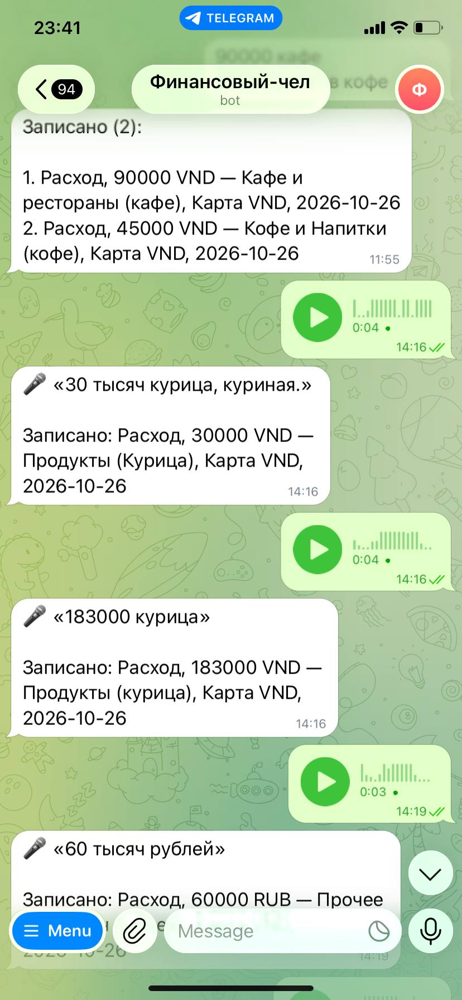
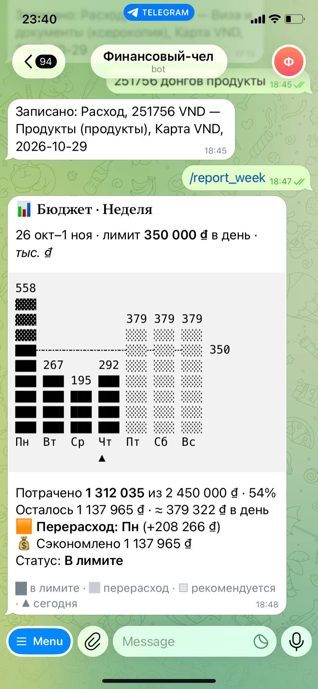
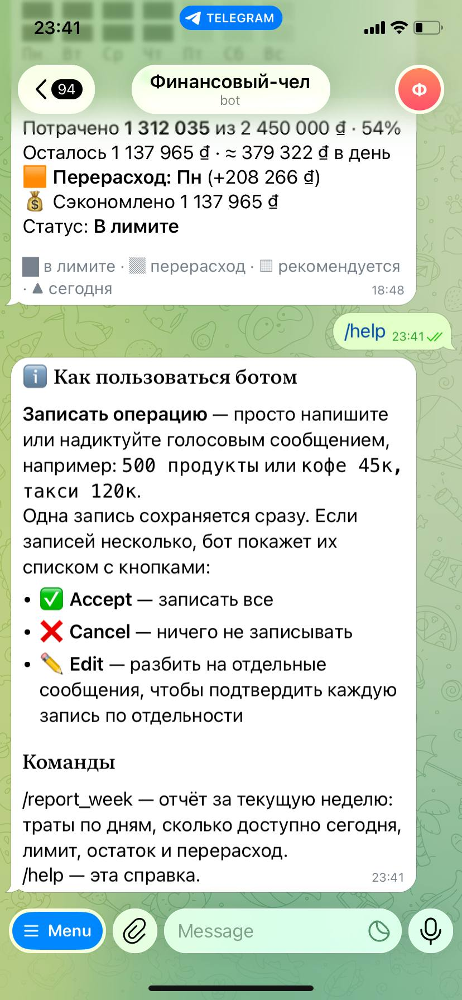
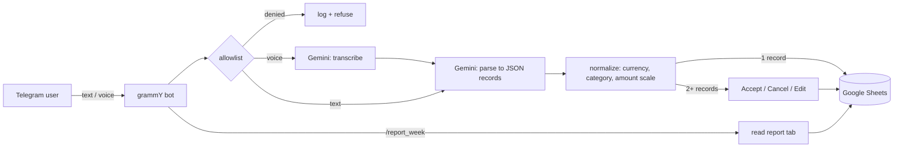

# Family Finance Bot

**English** · [Русский](README.ru.md)

> **🤖 This bot was built almost entirely by AI.** The main idea of the project was to create a working
> product with [Claude Code](https://claude.com/claude-code) while touching the code by hand as little
> as possible. All of the code, the commits and the documentation, including this README, were
> generated by Claude Code. My part was the goals, the constraints, testing in the real chat, and
> deciding what to do next.

A private Telegram bot that my partner and I use to track family expenses. You send it a text or
voice message like *"coffee 45k, taxi 120k"*, it works out what you meant with an LLM, and it writes
structured rows into our Google Sheets budget. It can also send back a weekly spending report as a chart.

> **Status: in daily use, active development finished.** We still use the bot every day. New features
> are no longer being added. This repository shows the project and how it was built. It is not meant as
> a ready-to-deploy product (the categories, currencies and sheet layout are specific to our budget).

| Voice and text records | Weekly report | Help |
|---|---|---|
|  |  |  |

## What it does

- **Text and voice input.** Voice messages are transcribed, and the transcript is shown in the reply so
  a misheard amount is easy to spot.
- **Natural language to structured records.** Each record gets a date, a type (income or expense), a
  payment source (card, cash, USDT, savings), an amount, a currency (RUB / VND / USDT), a category and a
  description.
- **Several records per message.** A single record is saved right away. Two or more are shown with
  **Accept / Cancel / Edit** buttons. *Edit* splits them so each one can be confirmed on its own.
- **`/report_week`.** The current week from the sheet's report tab as a bar chart: spend per day vs.
  the daily limit, overspent days, and how much is still available today.
- **Private.** Only allowlisted Telegram user IDs are served. Anyone else is refused and logged.

## The brief and its constraints

The project started from a short brief, kept as-is in [`goal.md`](goal.md):

1. **Telegram as the interface:** text, voice and photos.
2. **Write into one specific sheet** of an existing personal Google Spreadsheet.
3. **Private:** only two people may use it.
4. **No paid AI API budget.** The original idea was "send it to Claude", but there was no API budget.
   So the bot uses **Google Gemini on the free tier** (`gemini-flash-lite-latest`) for both parsing and
   voice transcription. Retries with backoff handle the free tier's rate limits.
5. **Iterative delivery:** every iteration has to be a complete, working product.

## Architecture

| File | Responsibility |
|---|---|
| [`src/index.ts`](src/index.ts) | Telegram handlers, allowlist, confirmation buttons, `/help` |
| [`src/gemini.ts`](src/gemini.ts) | Prompting, transcription, validation and normalization of records |
| [`src/sheets.ts`](src/sheets.ts) | Writing rows through the Google Sheets API (service account) |
| [`src/report.ts`](src/report.ts) | Reading the weekly report tab and drawing the chart |
| [`scripts/test-records.ts`](scripts/test-records.ts) | End-to-end check against sample messages, cleans up after itself |
| [`deploy/`](deploy), [`Dockerfile`](Dockerfile) | Docker image, VPS bootstrap and a deploy script with automatic rollback |

**Stack:** TypeScript, Node.js 22, [grammY](https://grammy.dev), Google Gemini API, Google Sheets API,
Docker, GitHub Actions, a small VPS.

## How it was built

The whole bot was written by [Claude Code](https://claude.com/claude-code), one small iteration at a
time, with almost no manual code edits. Each iteration followed the same loop: I described what I
wanted in plain words, Claude Code wrote the code, commits and pull requests, I tested the result in the
real chat, and then told it what to fix or build next. The commit history follows those iterations:

| # | Iteration | What changed |
|---|---|---|
| 1 | **Text → sheet** | Minimal working bot: text message → Gemini → one row in the sheet, with an allowlist |
| 2 | **Richer records** | Income/expense type and payment source; a model that is still supported; retries for rate limits |
| 3 | **Production** | Docker image, GitHub Actions → GHCR → VPS over SSH, automatic rollback if the bot doesn't stay up |
| 4 | **Multiple records** (#1) | One message can hold several transactions, confirmed with Accept/Cancel |
| 5 | **Voice** (#2) | Voice messages are transcribed by Gemini and go through the same pipeline |
| 6 | **Edit** (#3) | Split a multi-record confirmation into separate messages |
| 7 | **Reports** (#4, #6) | `/help` and `/report_week` with a weekly bar chart and today's available money |
| 8 | **Real-world fixes** (#5) | Bugs found in daily use (see below) |

### Problems found in real use

The most interesting bugs only showed up once the bot was in daily use:

- **"99 thousand" recorded as 99,000,000 ₫.** The transcript sometimes kept the multiplier both as
  digits and as a word ("99000 тысяч"). The fix was to tell the transcription to keep number and
  multiplier separate, and to move the "bare number means thousands of dong" shorthand from the prompt
  into code, so the model never scales amounts by itself.
- **Expenses in tenge.** "Тысячи эмм донгов" (thousands, um, dong) was heard as "тысячи тенге"
  (thousands of tenge) and recorded in KZT. The model now picks from a fixed list of currencies, and
  anything else falls back to the payment source's currency.
- **Lost spreadsheet formulas.** Appending with `INSERT_ROWS` added rows without the formula columns
  (exchange rate, sum in $, week, month) and overwrote a formula column. The fix fills the next
  pre-filled formula row in place and leaves formula cells untouched.
- **409 Conflict in development.** Only one process can poll a bot token, so local runs used a separate
  dev bot.

### Not done

Photos of receipts were in the brief but never built. Text and voice cover our real use.

## Running it yourself

This was built for one specific spreadsheet, so expect to adapt the categories, currencies and sheet
layout in `src/gemini.ts` and `src/sheets.ts`.

1. Create a bot with [@BotFather](https://t.me/BotFather) and get a Gemini key at
   [aistudio.google.com/apikey](https://aistudio.google.com/apikey).
2. Create a Google Cloud service account with the Sheets API enabled. Save its JSON key and share the
   spreadsheet with the service account's email as *Editor*.
3. Create a `.env` with `TELEGRAM_BOT_TOKEN`, `GEMINI_API_KEY`, `GOOGLE_SERVICE_ACCOUNT_KEY_FILE` (path
   to the JSON key), `SPREADSHEET_ID` and `ALLOWED_USER_IDS`. Optional variables are listed in
   [`deploy/bot.env.example`](deploy/bot.env.example). Leave `ALLOWED_USER_IDS` empty at first. The
   console logs the ID of each sender it refuses.
4. Run `npm install` and then `npm run dev`.

For deployment, `deploy/setup-vps.sh` prepares a Debian/Ubuntu VPS and `deploy/deploy.sh` pulls an
image and rolls back if the bot fails to start. The GitHub Actions deploy pipeline was removed from this
public copy. Only the typecheck and build workflow remains.
