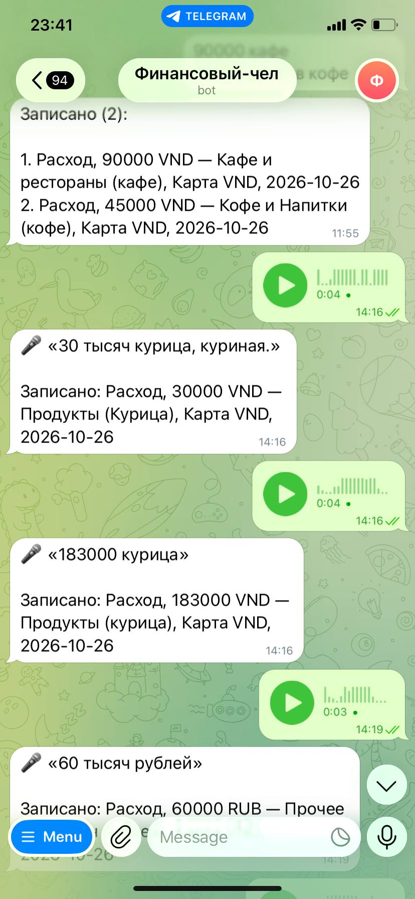
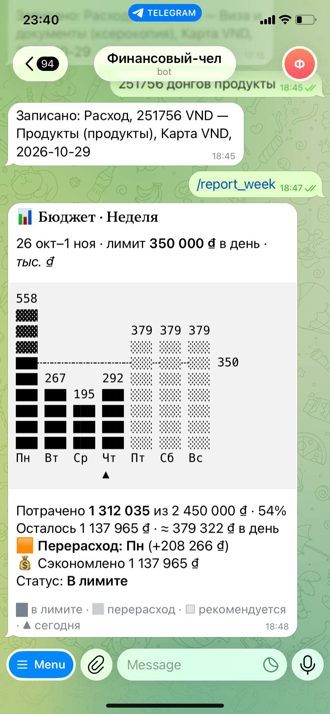
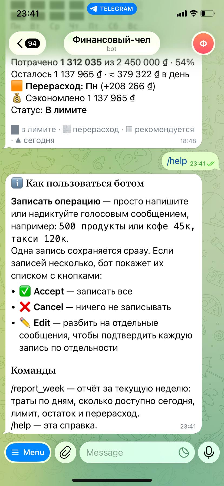
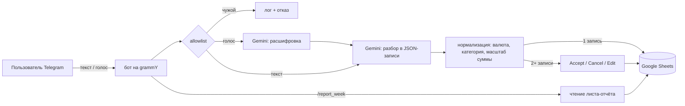

# Семейный финансовый бот

[English](README.md) · **Русский**

> **🤖 Этот бот почти полностью сделан AI.** Главная идея проекта была в том, чтобы создать рабочий
> продукт с помощью [Claude Code](https://claude.com/claude-code) и как можно меньше трогать код
> руками. Весь код, коммиты и документация, включая этот README, сгенерированы Claude Code. От меня были
> цели, ограничения, проверка в реальном чате и решения о том, что делать дальше.

Приватный Telegram-бот, с помощью которого мы с партнёршей ведём учёт семейных расходов. Ему можно
написать или надиктовать голосом, например, *«кофе 45к, такси 120к»*. Бот с помощью LLM разбирает,
что имелось в виду, и записывает структурированные строки в наш бюджет в Google Sheets. Ещё он умеет
присылать недельный отчёт о тратах в виде графика.

> **Статус: пользуемся каждый день, активная разработка завершена.** Бот по-прежнему работает у нас
> каждый день, новые функции больше не добавляются. Этот репозиторий показывает сам проект и то, как он
> делался. Это не готовый к развёртыванию продукт: категории, валюты и структура таблицы заточены под
> наш бюджет.

| Записи голосом и текстом | Недельный отчёт | Справка |
|---|---|---|
|  |  |  |

## Что умеет

- **Текст и голос.** Голосовые сообщения расшифровываются, и расшифровка показывается в ответе, чтобы
  было легко заметить неправильно услышанную сумму.
- **Свободный текст превращается в структурированную запись.** У каждой записи есть дата, тип (доход
  или расход), источник оплаты (карта, наличные, USDT, копилка), сумма, валюта (RUB / VND / USDT),
  категория и описание.
- **Несколько записей в одном сообщении.** Одна запись сохраняется сразу. Если их две и больше, бот
  показывает список с кнопками **Accept / Cancel / Edit**. *Edit* разбивает список, чтобы подтвердить
  каждую запись отдельно.
- **`/report_week`.** Текущая неделя из листа-отчёта в виде столбчатой диаграммы: траты по дням против
  дневного лимита, дни с перерасходом и сколько ещё доступно сегодня.
- **Приватность.** Бот отвечает только Telegram ID из allowlist. Остальным он отказывает и пишет
  попытку в лог.

## Исходная задача и ограничения

Проект начался с короткого брифа, он лежит без изменений в [`goal.md`](goal.md):

1. **Интерфейс — Telegram:** текст, голос и фото.
2. **Запись в один конкретный лист** существующей личной Google-таблицы.
3. **Приватность:** пользоваться могут только два человека.
4. **Нет бюджета на платный AI API.** Изначально идея была «отправлять в Claude», но платить за API
   было не из чего. Поэтому бот использует **Google Gemini на бесплатном тарифе**
   (`gemini-flash-lite-latest`) и для разбора текста, и для расшифровки голоса. Лимиты бесплатного
   тарифа обходятся повторными попытками с паузой.
5. **Итеративная разработка:** каждая итерация должна быть законченным рабочим продуктом.

## Архитектура

| Файл | За что отвечает |
|---|---|
| [`src/index.ts`](src/index.ts) | Обработчики Telegram, allowlist, кнопки подтверждения, `/help` |
| [`src/gemini.ts`](src/gemini.ts) | Промпты, расшифровка, проверка и нормализация записей |
| [`src/sheets.ts`](src/sheets.ts) | Запись строк через Google Sheets API (сервисный аккаунт) |
| [`src/report.ts`](src/report.ts) | Чтение недельного отчёта из таблицы и отрисовка графика |
| [`scripts/test-records.ts`](scripts/test-records.ts) | Сквозная проверка на примерах сообщений, после себя всё убирает |
| [`deploy/`](deploy), [`Dockerfile`](Dockerfile) | Docker-образ, подготовка VPS и скрипт деплоя с автооткатом |

**Стек:** TypeScript, Node.js 22, [grammY](https://grammy.dev), Google Gemini API, Google Sheets API,
Docker, GitHub Actions, небольшой VPS.

## Как это делалось

Весь бот написан [Claude Code](https://claude.com/claude-code) маленькими итерациями, почти без ручных
правок кода. Каждая итерация шла по одному циклу: я своими словами описывал, что хочу, Claude Code писал
код, коммиты и pull request'ы, я проверял результат в реальном чате и говорил, что исправить или
сделать дальше. История коммитов повторяет эти итерации:

| # | Итерация | Что изменилось |
|---|---|---|
| 1 | **Текст → таблица** | Минимальный рабочий бот: текст → Gemini → одна строка в таблице, плюс allowlist |
| 2 | **Подробные записи** | Тип (доход/расход) и источник оплаты; модель, которая ещё поддерживается; повторы при лимитах |
| 3 | **Прод** | Docker-образ, GitHub Actions → GHCR → VPS по SSH, автооткат, если бот не поднялся |
| 4 | **Несколько записей** (#1) | В одном сообщении может быть несколько операций, подтверждение через Accept/Cancel |
| 5 | **Голос** (#2) | Голосовые расшифровываются в Gemini и идут по тому же пути, что и текст |
| 6 | **Edit** (#3) | Разбить подтверждение нескольких записей на отдельные сообщения |
| 7 | **Отчёты** (#4, #6) | `/help` и `/report_week` с недельной диаграммой и суммой, доступной сегодня |
| 8 | **Исправления по итогам жизни** (#5) | Баги, найденные в ежедневном использовании (см. ниже) |

### Проблемы, которые всплыли в реальном использовании

Самые интересные баги проявились, только когда ботом начали пользоваться каждый день:

- **«99 тысяч» записывались как 99 000 000 ₫.** В расшифровке множитель иногда оставался и цифрами, и
  словом («99000 тысяч»). Исправление: расшифровка теперь держит число и множитель раздельно, а правило
  «голое число означает тысячи донгов» переехало из промпта в код. Модель больше сама суммы не
  масштабирует.
- **Расходы в тенге.** «Тысячи эмм донгов» распознавалось как «тысячи тенге» и записывалось в KZT.
  Теперь модель выбирает валюту из фиксированного списка, а всё остальное заменяется валютой источника
  оплаты.
- **Пропадали формулы в таблице.** Запись через `INSERT_ROWS` добавляла строки без формул (курс, сумма
  в $, неделя, месяц) и затирала столбец с формулой. Исправление: бот заполняет следующую заранее
  подготовленную строку с формулами на месте и не трогает ячейки с формулами.
- **409 Conflict при разработке.** Один токен бота может опрашивать только один процесс, поэтому для
  локального запуска заводился отдельный dev-бот.

### Что не сделано

Фото чеков были в брифе, но так и не появились: текста и голоса хватает для реального использования.

## Как запустить у себя

Бот сделан под одну конкретную таблицу, так что категории, валюты и структуру листа придётся поменять
в `src/gemini.ts` и `src/sheets.ts`.

1. Создайте бота через [@BotFather](https://t.me/BotFather) и получите ключ Gemini на
   [aistudio.google.com/apikey](https://aistudio.google.com/apikey).
2. Создайте сервисный аккаунт в Google Cloud с включённым Sheets API. Сохраните его JSON-ключ и
   откройте таблице доступ на редактирование для email сервисного аккаунта.
3. Создайте `.env` с `TELEGRAM_BOT_TOKEN`, `GEMINI_API_KEY`, `GOOGLE_SERVICE_ACCOUNT_KEY_FILE` (путь к
   JSON-ключу), `SPREADSHEET_ID` и `ALLOWED_USER_IDS`. Необязательные переменные перечислены в
   [`deploy/bot.env.example`](deploy/bot.env.example). `ALLOWED_USER_IDS` сначала оставьте пустым:
   бот пишет в консоль ID каждого, кому отказал.
4. Выполните `npm install`, затем `npm run dev`.

Для деплоя `deploy/setup-vps.sh` готовит VPS на Debian/Ubuntu, а `deploy/deploy.sh` подтягивает образ
и откатывается, если бот не стартовал. Пайплайн деплоя через GitHub Actions из публичной копии убран,
остался только workflow с проверкой типов и сборкой.
